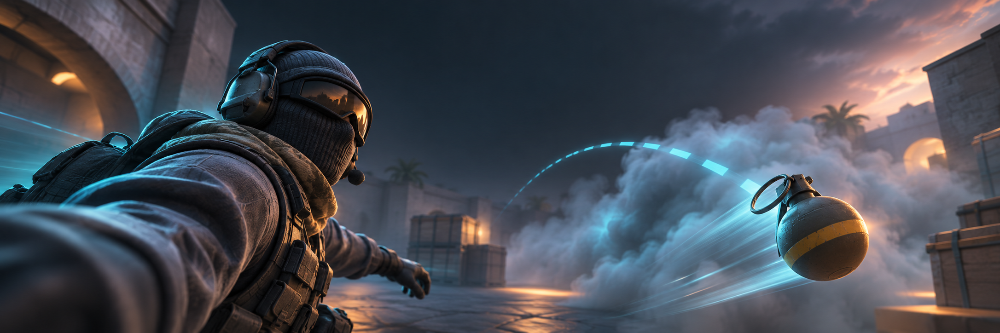

<div align="center">
  <a id="readme-top"></a>
  <a href="https://github.com/Lyan-edit/CS2-selfiestick/releases/latest">
    
  </a>

  <h1>CS2 Selfiestick</h1>

  <strong>Put the camera inside the action.</strong>
  <br />
  A cinematic spectator camera DLL for Counter-Strike 2 demos and HLAE.

  <br />
  <br />

  **English** · [简体中文](./README.zh-CN.md) · [Download](https://github.com/Lyan-edit/CS2-selfiestick/releases/latest) · [Manual](./release/en-US/Manual.md) · [Release notes](./release/RELEASE_NOTES.md) · [Report an issue](https://github.com/Lyan-edit/CS2-selfiestick/issues)

  <br />

  [](https://github.com/Lyan-edit/CS2-selfiestick/releases/latest)
  [](https://github.com/Lyan-edit/CS2-selfiestick/releases)
  [](https://github.com/Lyan-edit/CS2-selfiestick/stargazers)
  [](./LICENSE)
  <br />
  
  
  
  
</div>

<details>
<summary><kbd>Table of contents</kbd></summary>

- [Why Selfiestick](#-why-selfiestick)
- [Download](#-download)
- [Quick start](#-quick-start)
- [Camera modes](#-camera-modes)
- [Controls](#️-controls)
- [Compatibility and safety](#-compatibility-and-safety)
- [Troubleshooting](#-troubleshooting)
- [Build from source](#️-build-from-source)
- [Repository layout](#️-repository-layout)

</details>

## ✨ Why Selfiestick

CS2 Selfiestick turns HLAE demo playback into a compact cinematic camera rig. Frame an agent from a player-mounted camera, ride alongside a thrown grenade, or hand the shot back automatically after the effect lands.

<table>
  <tr>
    <td width="50%" valign="top">
      <b>🎭 Player Selfie</b><br />
      Symmetric left/right selfie framing, a shoulder preset, target follow/lock, and six-axis trim.
    </td>
    <td width="50%" valign="top">
      <b>💣 Prop Selfie</b><br />
      Follow smoke, molotov/incendiary, HE, flashbang, and decoy projectiles from launch through effect.
    </td>
  </tr>
  <tr>
    <td width="50%" valign="top">
      <b>🎬 Demo-aware handoff</b><br />
      Hold the final prop shot for two demo seconds, return to the agent, and stay armed for the next throw.
    </td>
    <td width="50%" valign="top">
      <b>🛡️ ReShade-safe panel</b><br />
      Genuine Dear ImGui controls on a CPU/GDI renderer—no D3D device, DXGI swap chain, OpenGL context, or Present hook.
    </td>
  </tr>
</table>

The current release also validates exact entity handles, fails closed on unknown game builds, keeps per-shot FOV, and exports motion diagnostics without writing files from camera callbacks.

<div align="right"><a href="#readme-top">Back to top ↑</a></div>

## 📦 Download

> [!IMPORTANT]
> Current stable release: **[v0.4.8](https://github.com/Lyan-edit/CS2-selfiestick/releases/tag/v0.4.8)** for **CS2 build `26598758`** and **HLAE `2.193.0` / AfxHookSource2 `0.42.0`**.

Get the bilingual Windows package from **[GitHub Releases](https://github.com/Lyan-edit/CS2-selfiestick/releases/latest)**. It includes both DLLs, manuals, the default configuration, and the hotkey reference.

| Asset | Use it for |
| :-- | :-- |
| `Lyan_selfiestick-v0.4.8-EN.dll` | English interface |
| `Lyan_selfiestick-v0.4.8-zh-CN.dll` | 中文界面 |
| `...windows-x64.zip` | Recommended complete bilingual package |
| `...source.zip` | Reproducible source package and validation tools |
| `SHA256SUMS.txt` | Release integrity verification |

The DLLs use the static MSVC runtime, so users do not need to install the Visual C++ Redistributable just to load Selfiestick with HLAE.

<div align="right"><a href="#readme-top">Back to top ↑</a></div>

## 🚀 Quick start

1. Fully restart HLAE/CS2, launch **HLAE 2.193.0**, and open a demo in spectator mode.
2. Download and extract the latest Windows package.
3. Load one language DLL from the HLAE console:

   ```cfg
   mirv_loadlibrary "D:\tools\selfiestick\en-US\Lyan's selfiestick.dll"
   ```

4. Press <kbd>Ins</kbd> to open the panel.
5. Press <kbd>F8</kbd> or select **Enable** in the panel.
6. For Prop Selfie setup, slow the demo to `0.1x`, tune the shot, then raise the playback speed.

   ```cfg
   demo_timescale 0.1
   ```

> [!TIP]
> Replacing a DLL on disk does not update code already loaded into CS2. Fully restart HLAE/CS2 after every DLL update.

The camera hook is installed lazily when Selfiestick is enabled. An incompatible runtime remains loaded and reports the reason in the panel instead of silently applying an unsafe fallback.

<div align="right"><a href="#readme-top">Back to top ↑</a></div>

## 🎥 Camera modes

### Player Selfie

The player rig uses a fixed agent-body frame, independent of hand, weapon and render-eye animation. The engine resolves body position before sampling, stance controls camera height, and the final pose is written after native view processing. Local yaw uses a short demo-rate-aware transition; FOV stays fixed for each agent/enable session.

- **Selfie Left / Right** — mirrored front-facing compositions.
- **Over Shoulder** — forward view with the agent in the left foreground.
- **Follow / Lock Current / Clear** — control the spectator target.
- **R / B / U** — local right, back, and up position trim.
- **Pitch / Yaw / Roll** — local angle trim on top of the built-in framing.

Framing v6 backs up older settings to `selfiestick.ini.pre-hand-anchor.bak` before resetting obsolete player trim once. Prop trim is retained.

### Prop Selfie

The prop rig follows projectiles owned or thrown by the current target:

`smoke` · `molotov / incendiary` · `HE` · `flashbang` · `decoy`

- **AUTO HANDOFF** — follows through detonation, holds the final view for **two demo seconds**, then returns to the agent while waiting for future throws.
- **PIN CURRENT PROP** — keeps the selected shot through detonation and holds its final view indefinitely.
- **SELECT + PIN** — chooses a specific live candidate and pins it.
- **CLEAR LOCK / RETURN TO AGENT** — releases the current view immediately without recapturing the same cleared candidates.
- **X / Y / Z + Pitch / Yaw / Roll** — six-axis local prop framing.
- **Centered Lookback Preset** — restores `X=0`, `Y=-13.5`, `Z=2.25` and zero angle trim.

Pause stops the handoff timer, slow playback extends its wall-clock duration, and a newer valid throw can take over immediately. The camera uses one resolved scene sample for position and aim, so its prop-relative distance does not drift with playback speed, FPS, or refresh timing.

> [!NOTE]
> Automatic map-geometry collision avoidance is not implemented. A projectile that exists entirely between two visible camera callbacks may still require slower playback to capture.

<div align="right"><a href="#readme-top">Back to top ↑</a></div>

## ⌨️ Controls

| Key | Action |
| :--: | :-- |
| <kbd>Ins</kbd> | Show or hide the Dear ImGui panel |
| <kbd>F8</kbd> | Enable or disable Selfiestick |
| <kbd>F9</kbd> | Lock the current spectator target |
| <kbd>F10</kbd> | Return target mode to Follow |

The panel hotkey is configurable and saved to `selfiestick.ini` next to the loaded DLL.

## 🧩 Compatibility and safety

| Component | Supported target |
| :-- | :-- |
| Counter-Strike 2 | Steam app `730`, buildid `26598758` |
| HLAE | `2.193.0`, AfxHookSource2 `0.42.0` |
| Platform | Windows x64 |
| Workflow | HLAE demo playback and cinematic capture |

CS2 and HLAE update frequently. If schema, entity layout, or `SetUpView` changes, Selfiestick may block hook installation by design and show the reason in Runtime diagnostics.

> [!CAUTION]
> Selfiestick is for offline demo and cinematic workflows. It is not intended for matchmaking, live play, or anti-cheat protected servers. Joining VAC-protected servers with HLAE or injected tools can be unsafe.

<div align="right"><a href="#readme-top">Back to top ↑</a></div>

## 🩺 Troubleshooting

<details>
<summary><b><code>mirv_loadlibrary failed</code></b></summary>

Fully restart HLAE/CS2 and verify the absolute DLL path. The v0.4.8 release DLLs do not depend on `MSVCP140.dll`, `VCRUNTIME140.dll`, UCRT `api-ms-win-crt-*` DLLs, `D3DCOMPILER_*.dll`, `D3D11.dll`, or `DXGI.dll`.

</details>

<details>
<summary><b><code>SetUpView hook blocked by compatibility gate</code></b></summary>

The DLL loaded successfully, but the current game/runtime fingerprint was rejected. Use CS2 build `26598758` with HLAE `2.193.0`, or rebuild only after validating the newer binaries.

</details>

<details>
<summary><b>Old settings or unexpected trace logging</b></summary>

Delete an older `selfiestick.ini`, or confirm that it contains:

```ini
[Debug]
TraceEnabled=0
```

Existing INI values override new defaults.

</details>

<details>
<summary><b>Collect motion diagnostics</b></summary>

Expand **Runtime** and select **EXPORT MOTION DIAGNOSTICS**. The latest 1,024 in-memory camera samples are written beside the DLL: `selfiestick_player_motion.csv` in Player mode (34 columns, including early/final callback stage and thread ID), or `selfiestick_prop_motion.csv` in Prop mode. For a debug trace, set `TraceEnabled=1`, restart HLAE/CS2, and reproduce the problem; output is written to `selfiestick_trace.log`.

The expected v0.4.8 trace marker is:

```text
schema-probe-v43-prop-origin-cs2-26598758
```

</details>

### v0.4.8 engineering notes

<details>
<summary>Show implementation and validation details</summary>

- Player framing uses resolved body origin and verified stance fields; camera geometry is independent of active weapons. Render-eye slot 173 remains validated for auxiliary paths.
- The player pose is applied at the final native SetUpView stage; shared session FOV prevents weapon changes from recapturing it.
- Exact handle serial validation rejects reused entity slots; weapon restoration never falls back to an unvalidated saved pointer.
- Prop discovery combines creation observation with a resumable `0..32767` slot sweep and a 0.5 ms soft callback budget.
- Projectile position is read through the verified engine absolute-origin accessor so dirty scene transforms are resolved before sampling.
- Temporarily missing data keeps the last validated view; a pending shot takes over only when its pose is usable.
- The production panel renders complete off-screen CPU/GDI frames and never creates a graphics device or Present hook.
- Compatibility resolution uses the exact supported PE fingerprint and fails closed on unknown builds.

The prop resolved-origin shake fix was confirmed in a live user test, and the user confirmed that body-fix2 stopped player clipping. The final-view player fix and v0.4.8 release passed background/native regression checks only; remaining real-demo turning/knife jitter has not been confirmed resolved. HLAE 2.193.0 compatibility was checked against its official source and local package, without a new live-demo, ReShade-coexistence, or FPS test. See the [stable baseline](./docs/2026-11-08-confirmed-stable-fix5.md), [lifecycle update](./docs/2026-11-08-prop-hold-fix6.md), and [release validation](./docs/2026-11-13-v0.4.8-release-validation.md).

</details>

<div align="right"><a href="#readme-top">Back to top ↑</a></div>

## 🛠️ Build from source

Requirements: Visual Studio 2022, the MSVC C++ toolchain, Windows SDK, and PowerShell 7.

```powershell
pwsh -NoProfile -File tools/Build-Native.ps1 -Target Dll -Language zh-CN
pwsh -NoProfile -File tools/Build-Native.ps1 -Target Dll -Language en-US
pwsh -NoProfile -File tools/Build-Native.ps1 -Target Validation
pwsh -NoProfile -File tools/Build-Native.ps1 -Target UiPreview -Language zh-CN
```

Outputs are written under `native_dll/bin/native-<Target>-<Language>/`. The UI preview executes production panel code in a hidden standalone process and checks default styling and rasterization without starting the game or installing hooks.

<details>
<summary><b>Binary compatibility and dependency checks</b></summary>

```powershell
py -3 tools\check_cs2_binary_compatibility.py --client "<CS2>\game\csgo\bin\win64\client.dll" --schema "<CS2>\game\bin\win64\schemasystem.dll"

powershell -NoProfile -ExecutionPolicy Bypass -File tools\check_dll_dependencies.ps1 -DllPath "release\en-US\Lyan's selfiestick.dll"
powershell -NoProfile -ExecutionPolicy Bypass -File tools\check_dll_dependencies.ps1 -DllPath "release\zh-CN\Lyan_CS2自拍杆.dll"
```

The compatibility checker validates the PE fingerprint, signatures, attachment call targets, the `SetUpView` instruction boundary and context, and build-gated schema fields. The dependency check rejects runtime and graphics-hook imports that should not be present in release DLLs.

</details>

<details>
<summary><b>Release packaging</b></summary>

```powershell
pwsh -NoLogo -NoProfile -ExecutionPolicy Bypass -File tools\New-SelfiestickRelease.ps1 -Version v0.4.8 -Cs2Build 26598758 -HlaeVersion 2.193.0
pwsh -NoLogo -NoProfile -ExecutionPolicy Bypass -File tools\Publish-GitHubRelease.ps1 -Version v0.4.8
```

The publisher creates a draft release, uploads the bilingual DLLs, Windows bundle, source bundle, and checksum file, then verifies remote sizes and SHA-256 hashes before publication. Authentication comes from Git Credential Manager and is never printed.

</details>

Do not run `npm run build` for this repository; the native DLL flow is independent of the Next.js guidance used by unrelated projects.

## 🗂️ Repository layout

```text
assets/                                  README artwork
native_dll/selfiestick_hlae/             Main DLL source and Visual Studio project
native_dll/selfiestick_hlae_validation/  Native validation executable
native_dll/third_party/imgui/             Dear ImGui source and Win32 backend
release/en-US/                           English release DLL and manual
release/zh-CN/                           Chinese release DLL and manual
tools/                                   Build, compatibility, and release tooling
selfiestick_bind.cfg                     Hotkey reference
```

Issues and pull requests are welcome. For runtime changes, include the exact CS2 build, HLAE version, reproduction steps, and relevant Runtime diagnostics.

## 📄 License

Released under the [MIT License](./LICENSE).

<div align="center">
  <sub>Built for CS2 demo filmmakers and HLAE camera work.</sub>
  <br />
  <a href="#readme-top">Back to top ↑</a>
</div>
