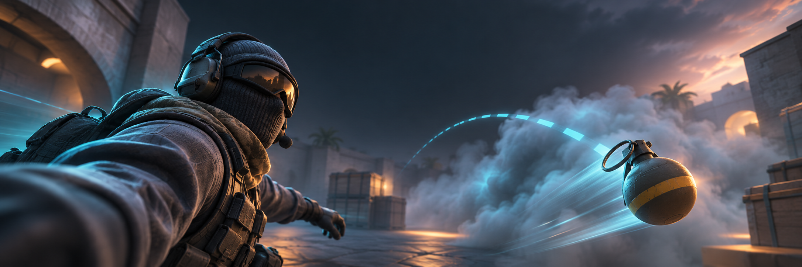

<div align="center">
  <a id="readme-top"></a>
  <a href="https://github.com/Lyan-edit/CS2-selfiestick/releases/latest">
    
  </a>

  <h1>CS2 自拍杆</h1>

  <strong>让镜头进入动作中心。</strong>
  <br />
  面向 Counter-Strike 2 Demo 与 HLAE 的电影化观战镜头 DLL。

  <br />
  <br />

  [English](./README.md) · **简体中文** · [下载](https://github.com/Lyan-edit/CS2-selfiestick/releases/latest) · [完整操作手册](./release/zh-CN/操作手册.md) · [更新说明](./release/RELEASE_NOTES.md) · [反馈问题](https://github.com/Lyan-edit/CS2-selfiestick/issues)

  <br />

  [](https://github.com/Lyan-edit/CS2-selfiestick/releases/latest)
  [](https://github.com/Lyan-edit/CS2-selfiestick/releases)
  [](https://github.com/Lyan-edit/CS2-selfiestick/stargazers)
  [](./LICENSE)
  <br />
  
  
  
  
</div>

<details>
<summary><kbd>目录</kbd></summary>

- [为什么使用自拍杆](#-为什么使用自拍杆)
- [下载](#-下载)
- [快速开始](#-快速开始)
- [两种镜头模式](#-两种镜头模式)
- [热键](#️-热键)
- [兼容性与安全](#-兼容性与安全)
- [排错](#-排错)
- [从源码构建](#️-从源码构建)

</details>

## ✨ 为什么使用自拍杆

CS2 自拍杆把 HLAE Demo 播放变成一套轻量的电影镜头系统：既能从人物身边拍摄自拍与越肩画面，也能贴着投掷物飞行，并在爆开后自动把镜头交还给探员。

<table>
  <tr>
    <td width="50%" valign="top">
      <b>🎭 人物自拍</b><br />
      左右对称自拍、越肩预设、目标跟随/锁定，以及六轴构图微调。
    </td>
    <td width="50%" valign="top">
      <b>💣 道具自拍</b><br />
      跟随烟、火、雷、闪和诱饵，从出手一路拍到效果触发。
    </td>
  </tr>
  <tr>
    <td width="50%" valign="top">
      <b>🎬 Demo 时间接续</b><br />
      爆开后保留最终机位两秒，再回到探员，并继续等待下一次投掷。
    </td>
    <td width="50%" valign="top">
      <b>🛡️ ReShade 友好</b><br />
      Dear ImGui + CPU/GDI 软件渲染，不创建 D3D/DXGI/OpenGL 上下文，也不挂接 Present。
    </td>
  </tr>
</table>

当前版本还包含精确实体句柄校验、未知游戏版本安全阻断、逐镜头 FOV 保持，以及不会在相机回调里写文件的运动诊断导出。

<div align="right"><a href="#readme-top">返回顶部 ↑</a></div>

## 📦 下载

> [!IMPORTANT]
> 当前正式版为 **[v0.4.8](https://github.com/Lyan-edit/CS2-selfiestick/releases/tag/v0.4.8)**，对应 **CS2 build `26598758`** 与 **HLAE `2.193.0` / AfxHookSource2 `0.42.0`**。

推荐从 **[GitHub Releases](https://github.com/Lyan-edit/CS2-selfiestick/releases/latest)** 下载双语 Windows 完整包，其中包含中英文 DLL、操作手册、默认配置和热键参考。

| 附件 | 用途 |
| :-- | :-- |
| `Lyan_selfiestick-v0.4.8-zh-CN.dll` | 中文界面 |
| `Lyan_selfiestick-v0.4.8-EN.dll` | English interface |
| `...windows-x64.zip` | 推荐的双语完整包 |
| `...source.zip` | 完整源码和验证工具 |
| `SHA256SUMS.txt` | 校验发布附件完整性 |

DLL 已静态链接 MSVC 运行库，仅为通过 HLAE 加载本项目，无需额外安装 Visual C++ Redistributable。

## 🚀 快速开始

1. 完整重启 HLAE/CS2，使用 **HLAE 2.193.0** 启动游戏并打开 Demo 观战。
2. 下载并解压最新 Windows 完整包。
3. 在 HLAE 控制台加载中文 DLL：

   ```cfg
   mirv_loadlibrary "D:\tools\selfiestick\zh-CN\Lyan_CS2自拍杆.dll"
   ```

4. 按 <kbd>Ins</kbd> 打开面板。
5. 按 <kbd>F8</kbd> 或点击面板里的启用按钮。
6. 调整道具自拍时，建议先把 Demo 降至 `0.1x`，构图稳定后再恢复速度。

   ```cfg
   demo_timescale 0.1
   ```

> [!TIP]
> 直接覆盖磁盘上的 DLL 不会更新 CS2 进程中已经加载的代码。每次更新 DLL 后都要完整重启 HLAE/CS2。

相机热补丁只在启用自拍杆时延迟安装。若运行环境不兼容，DLL 会保持加载并在面板里说明原因，不会偷偷使用不安全的降级方案。

<div align="right"><a href="#readme-top">返回顶部 ↑</a></div>

## 🎥 两种镜头模式

### 人物自拍

人物相机使用探员身体的固定局部机位，脱离手部、武器及动画眼位。身体坐标先由引擎重算，下蹲高度控制机位高度，最终构图在原生视角处理后写入；偏航按 Demo 时间短时过渡，同一探员／启用代次保持 FOV。

- **左侧 / 右侧自拍**：镜像对称的正面构图。
- **越肩视角**：向前拍摄，并让探员保留在画面左侧前景。
- **跟随 / 锁定当前 / 清除**：控制目标探员。
- **右 / 后 / 上**：局部位置微调。
- **俯仰 / 偏航 / 翻滚**：在内置构图上继续调整角度。

构图版本 6 首次迁移时，会把旧设置备份到 `selfiestick.ini.pre-hand-anchor.bak`，只重置已经过时的人物微调，道具参数会被保留。

### 道具自拍

道具相机只跟随当前目标探员拥有或投出的飞行物：

`烟` · `火（燃烧瓶 / 燃烧弹）` · `雷` · `闪` · `诱饵`

- **自动接续**：跟随至实际爆开，最终机位保持 **Demo 时间两秒**，随后回到探员并等待下一次投掷。
- **锁定当前道具**：跟随当前道具，并在爆开后无限保留最终机位。
- **选中并锁定**：从最近道具里选择一颗有效候选并锁定。
- **清除锁定并返回探员**：立即释放镜头，而且不会下一帧又抓回刚清除的候选。
- **X / Y / Z + 俯仰 / 偏航 / 翻滚**：六轴道具构图。
- **居中回看预设**：恢复 `X=0`、`Y=-13.5`、`Z=2.25` 和零角度微调。

暂停会停止接续计时，慢放会延长现实停留时间；新的有效道具可立即接管，无需等待上一颗的两秒停留结束。相机位置与朝向使用同一次场景采样，因此相对距离不会随倍速、帧率或刷新时机漂移。

> [!NOTE]
> 当前没有自动地图碰撞避让。如果某个短寿命道具完全存在于两次可见相机回调之间，仍可能需要慢放才能捕获。

更完整的行为规则和面板说明请阅读 **[中文操作手册](./release/zh-CN/操作手册.md)**。

## ⌨️ 热键

| 按键 | 操作 |
| :--: | :-- |
| <kbd>Ins</kbd> | 显示 / 隐藏 Dear ImGui 面板 |
| <kbd>F8</kbd> | 启用 / 关闭自拍杆 |
| <kbd>F9</kbd> | 锁定当前观战目标 |
| <kbd>F10</kbd> | 目标模式回到跟随 |

面板开关键可以修改，并保存到 DLL 同目录的 `selfiestick.ini`。

## 🧩 兼容性与安全

| 组件 | 已支持目标 |
| :-- | :-- |
| Counter-Strike 2 | Steam app `730`，buildid `26598758` |
| HLAE | `2.193.0`，AfxHookSource2 `0.42.0` |
| 平台 | Windows x64 |
| 用途 | HLAE Demo 播放与影视镜头制作 |

CS2 与 HLAE 经常更新。如果 schema、实体布局或 `SetUpView` 发生变化，自拍杆可能主动阻止热补丁安装，并在运行状态区显示原因。

> [!CAUTION]
> 本项目仅面向离线 Demo 与影视制作流程，不用于匹配、实时对局或反作弊保护服务器。携带 HLAE 或注入工具进入 VAC 保护服务器可能不安全。

<div align="right"><a href="#readme-top">返回顶部 ↑</a></div>

## 🩺 排错

<details>
<summary><b><code>mirv_loadlibrary failed</code></b></summary>

完整重启 HLAE/CS2，并检查 DLL 绝对路径。v0.4.8 DLL 不依赖 `MSVCP140.dll`、`VCRUNTIME140.dll`、UCRT `api-ms-win-crt-*`、`D3DCOMPILER_*.dll`、`D3D11.dll` 或 `DXGI.dll`。

</details>

<details>
<summary><b><code>SetUpView hook blocked by compatibility gate</code></b></summary>

DLL 已加载，但当前游戏或运行环境的指纹未通过校验。请使用 CS2 build `26598758` 与 HLAE `2.193.0`，或在验证新二进制后重新构建。

</details>

<details>
<summary><b>导出运动诊断</b></summary>

展开“运行状态”，点击“导出运动诊断”。最近 1,024 条内存相机样本会写入 DLL 旁：人物模式为 `selfiestick_player_motion.csv`（34 列，含早期／末尾回调阶段与线程 ID），道具模式为 `selfiestick_prop_motion.csv`。如需调试日志，把 `selfiestick.ini` 中的 `TraceEnabled` 改为 `1`，重启并复现；日志输出到 `selfiestick_trace.log`。

v0.4.8 应显示以下追踪标记：

```text
schema-probe-v43-prop-origin-cs2-26598758
```

</details>

### v0.4.8 验证说明

fix5 的道具坐标无抖动修复，以及 body-fix2 不再穿模的状态已经过用户实机确认。人物末尾覆写修正与 v0.4.8 发布只完成后台／原生回归；尚未收到实机确认转身／切刀残余抖动已消除。HLAE 2.193.0 通过官方源码及本地包静态核查，本次没有追加实机 Demo、ReShade 共存或 FPS 测试。详见[稳定基线](./docs/2026-11-08-confirmed-stable-fix5.md)、[机位生命周期更新](./docs/2026-11-08-prop-hold-fix6.md)和[发布验证](./docs/2026-11-13-v0.4.8-release-validation.md)。

## 🛠️ 从源码构建

需要 Visual Studio 2022、MSVC C++ 工具链、Windows SDK 与 PowerShell 7。

```powershell
pwsh -NoProfile -File tools/Build-Native.ps1 -Target Dll -Language zh-CN
pwsh -NoProfile -File tools/Build-Native.ps1 -Target Dll -Language en-US
pwsh -NoProfile -File tools/Build-Native.ps1 -Target Validation
pwsh -NoProfile -File tools/Build-Native.ps1 -Target UiPreview -Language zh-CN
```

输出位于 `native_dll/bin/native-<Target>-<Language>/`。UI 预览会在隐藏的独立进程中运行生产面板代码，检查默认样式和光栅化，不会启动游戏或安装热补丁。

```text
assets/                                  README 视觉资源
native_dll/selfiestick_hlae/             DLL 主源码和 Visual Studio 工程
native_dll/selfiestick_hlae_validation/  原生验证程序
release/en-US/                           英文 DLL 与手册
release/zh-CN/                           中文 DLL 与手册
tools/                                   构建、兼容性和发布工具
```

## 📄 许可证

本项目采用 [MIT License](./LICENSE) 开源。

<div align="center">
  <sub>为 CS2 Demo 影视作者与 HLAE 镜头工作流打造。</sub>
  <br />
  <a href="#readme-top">返回顶部 ↑</a>
</div>
